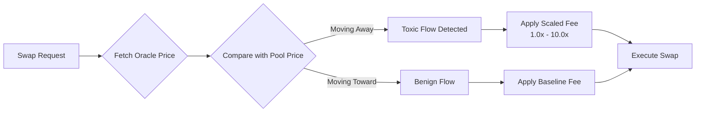
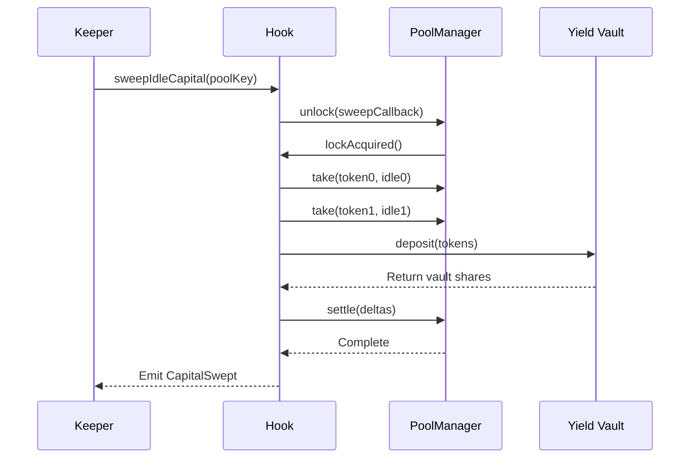
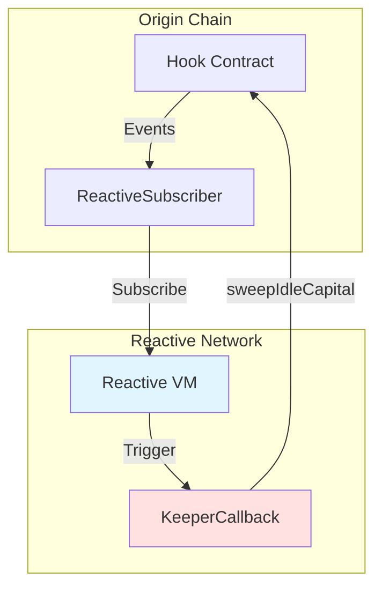

# Yield Subsidized Directional Hook

[](https://soliditylang.org/)
[](https://uniswap.org/)
[](https://getfoundry.sh/)
[](LICENSE)
[](test/)
[](CONTRIBUTING.md)

A Uniswap v4 hook that tries to offset impermanent loss for liquidity providers: it scales swap fees up on oracle-adverse flow, routes idle out-of-range capital into ERC-4626 vaults, and pays the resulting yield back to LPs as an IL subsidy.

> ⚠️ **Not audited. Not deployed to mainnet.** This is hackathon-stage research code. Almost all tests run against a mock `PoolManager`; only the fee path is exercised against the real v4 `PoolManager` (see [Testing](#testing)). Do not use it with real funds.

> 🏆 **UHI9 2026 Hackathon Submission** - Theme: Impermanent Loss & Yield Systems

---

## 📑 Table of Contents

- [Overview](#overview)
- [Status and Scope](#status-and-scope)
- [Features](#features)
- [Design Tradeoffs](#design-tradeoffs)
- [How It Works](#how-it-works)
- [Architecture](#architecture)
- [Installation](#installation)
- [Usage](#usage)
- [Testing](#testing)
- [Security](#security)
- [Documentation](#documentation)
- [Roadmap](#roadmap)
- [Contributing](#contributing)
- [License](#license)

---

## Overview

The **Yield Subsidized Directional Hook** combines three mechanisms to reduce LP impermanent loss (IL). Whether the yield and fee uplift can actually cover IL in practice is untested: nothing here has been run against a real pool, real vaults, or live oracle data.

### The Problem

Traditional AMMs expose liquidity providers to:
- **Impermanent Loss**: Capital opportunity cost from price divergence
- **Toxic Arbitrage**: Informed traders exploiting stale prices at LP expense
- **Idle Capital Inefficiency**: Out-of-range liquidity generating zero returns

### The Solution

This hook implements a closed-loop IL mitigation system:

1. **Directional Fee Scaling** - Tax toxic arbitrage flow via oracle-based price comparison
2. **External Yield Generation** - Route idle out-of-range capital to ERC-4626 yield vaults
3. **IL Subsidy Distribution** - Compensate LPs for impermanent loss using accumulated yield

---

## Status and Scope

**Stack:** Solidity 0.8.26+ (`via_ir`), Foundry, Uniswap v4 core, OpenZeppelin (ERC-1155 claim tokens, `ReentrancyGuard`), ERC-4626 vaults, Reactive Network for optional keeper automation.

| | |
|---|---|
| Audit | None. SECURITY.md lists an external audit as planned, not done. |
| Deployment | None, on any network. |
| Tests | 266 Foundry tests passing (unit, integration, a handful of fuzz tests). Almost all use a **mock** PoolManager; 5 swap tests in `RealPoolManagerSwap.t.sol` use the real v4 one. |
| Hook permissions | `beforeInitialize`, `beforeSwap`, `beforeRemoveLiquidity` only. Pools must be created with the dynamic-fee flag. |

**Known gaps** (verified against the source, not exhaustive):

- LP identity on removal is taken from `tx.origin`, which breaks for smart-contract wallets and routers.
- Post-swap price in flow classification is a simplified approximation, not v4 tick math (`estimatePostSwapPrice`).
- Only a single oracle per pool; if it is stale or invalid the hook falls back to the base fee.
- Vault trust is assumed: a malicious or insolvent ERC-4626 vault can lock or lose swept capital. The claim-token path handles illiquidity, not insolvency.
- No invariant tests, no fork tests against a real PoolManager, no adversarial vault or oracle tests.

---

## Features

### Core Mechanisms

- **Dynamic Fee Engine**
  - Oracle-based toxic flow detection
  - Linear fee scaling proportional to price deviation
  - Configurable fee curves per pool

- **Asynchronous Capital Management**
  - Flash accounting integration via Uniswap v4 unlock/lock pattern
  - Automated capital sweeps via Reactive Network
  - Permissionless keeper model for decentralized automation
  - ERC-4626 vault compatibility for yield generation
  - Real-time yield tracking and attribution

- **IL Compensation System**
  - Precise IL calculation using initial deposit tracking
  - Pro-rata subsidy distribution from yield pools
  - Automatic compensation on liquidity removal
  - Partial subsidy support with transparent accounting

- **Claim Token Safety Net (ERC-1155)**
  - Non-blocking LP withdrawals during vault illiquidity
  - Redeemable claim tokens for locked capital
  - Transferable claims with metadata tracking
  - Graceful vault failure handling

### Security & Reliability

- Access Control: Anti-callback spoofing via PoolManager validation
- Reentrancy Protection: OpenZeppelin guards on all state-changing functions
- Gas Safety: Limited external calls with fallback behavior
- Oracle Manipulation Resistance: Staleness checks and sanity bounds
- Fail-Safe Design: Vault failures never block LP operations
- Emergency Pause: Admin controls for crisis management

### Developer Experience

- Per-pool configuration and accounting, keyed by `PoolId`
- Unit and integration tests plus a few fuzz tests (no invariant tests yet)
- Event emission for analytics and monitoring
- NatSpec on the main contract

---

## Design Tradeoffs

> Draft. This section records the reasoning visible in the code; it is the part most worth refining.

**Why scale fees by direction rather than by volatility or a flat fee.**
A flat fee charges rebalancing flow and toxic flow the same. Volatility-based dynamic fees raise the cost for everyone when the market moves, including trades that push the pool *toward* fair value. Here, `classifyFlow` compares the pool price before and after the swap against an oracle price. Only swaps that increase the deviation, and end above `deviationThresholdBps`, pay a scaled fee. Everything else pays the base fee, and the multiplier is capped by `maxFeeMultiplier` (hard cap 10x).

**What this costs.**
- An oracle dependency on the swap path. Stale or out-of-bounds prices (5 minute staleness, 50% sanity bound) fall back to the base fee rather than reverting, so an oracle outage degrades protection instead of halting swaps.
- Extra gas on every swap for the oracle read (the call is capped at 100k gas).
- Oracle prices more than 50% away from the pool price are rejected as invalid, so protection switches off exactly when the pool has diverged most.
- Classification is only as good as the post-swap price estimate, which is currently approximate.
- The scaling is linear above the threshold. Other curves (exponential, sigmoid) are listed in the roadmap and are not implemented.

**Why sweep idle capital to vaults, and why claim tokens.**
Out-of-range liquidity earns no fees. Sweeping it into ERC-4626 vaults makes it productive, and the yield funds the subsidy. The risk is that LP withdrawals would depend on vault liquidity, so when a vault withdrawal fails, the LP receives an ERC-1155 claim token redeemable later instead of having removal blocked. This trades withdrawal liveness for deferred settlement. It does not protect against vault insolvency.

**Alternatives not taken here:** oracle-free fee schemes, auction or rebate designs that return LVR to LPs, and pause-on-deviation. They avoid the oracle dependency, but were not evaluated in this repository.

---

## How It Works

### Directional Fee Scaling



**Classification Logic:**
- Fetch external oracle price with staleness validation
- Compare swap direction against oracle price
- Classify as toxic if moving pool price away from fair value
- Scale fee proportionally to price deviation magnitude

### Capital Sweep Flow



**Execution Steps:**
1. **Reactive Network monitors** pool liquidity events for idle capital
2. Keeper (manual or automated) identifies idle out-of-range capital
3. Hook initiates flash accounting via PoolManager.unlock()
4. Withdraws idle tokens using take operations
5. Deposits to external ERC-4626 vaults
6. Tracks vault shares and principal amounts
7. Settles delta accounting to zero

### IL Subsidy Distribution

```
LP Position at T0:
  Token0: 100 USDC | Token1: 0.05 ETH
  Price: 2000 USDC/ETH
  Hold Value: 200 USDC

LP Position at T1 (Remove Liquidity):
  Token0: 141.42 USDC | Token1: 0.035 ETH
  Price: 3000 USDC/ETH
  Position Value: 246.42 USDC
  Hold Value: 250 USDC
  IL: 3.58 USDC (1.43%)

Subsidy Calculation:
  Available Yield: 5.2 USDC
  Subsidy Applied: 3.58 USDC (full IL coverage)
  Final LP Payout: 250 USDC (IL-free)
```

---

## Architecture

### Component Overview

```
YieldSubsidizedDirectionalHook
├── Hook Callbacks (beforeInitialize, beforeSwap, beforeRemoveLiquidity)
├── Oracle Manager (Price fetching & validation)
├── Fee Scaling Engine (Toxicity classification & fee calculation)
├── Capital Sweep Manager (Flash accounting orchestration)
├── IL Calculator (Impermanent loss measurement)
├── Subsidy Distributor (Yield allocation to LPs)
├── Claim Token System (ERC-1155 for locked capital)
└── Reactive Network Integration (Automated keeper operations)
```

### Reactive Network Automation

The hook integrates with [Reactive Network](https://reactive.network) for trustless, decentralized automation:



**Benefits:**
- No centralized keeper infrastructure required
- Event-driven automation (triggers on liquidity changes)
- Configurable thresholds and intervals
- Cost-efficient (only executes when profitable)
- Fully auditable and transparent

**See:** [Reactive Network Integration Guide](docs/REACTIVE_NETWORK_INTEGRATION.md)

### Smart Contract Structure

```solidity
contract YieldSubsidizedDirectionalHook is 
    IHooks,             // Uniswap v4 hook interface
    ERC1155,            // Claim token implementation
    ReentrancyGuard     // Security protection
{
    // Core State
    mapping(PoolId => bool) registeredPools;
    mapping(PoolId => PoolConfig) poolConfigs;
    mapping(PoolId => SubsidyPool) subsidyPools;
    mapping(address => mapping(PoolId => LPPosition)) lpPositions;
    mapping(uint256 => ClaimTokenMetadata) claimTokenMetadata;
    
    // Key Functions
    function beforeSwap(...) external override onlyPoolManager;
    function beforeRemoveLiquidity(...) external override onlyPoolManager;
    function sweepIdleCapital(PoolKey) external nonReentrant;
    function redeemLockedCapital(uint256 tokenId, uint256 amount) external;
}
```

### External Interfaces

```solidity
interface IOracle {
    function getPrice(address token0, address token1) 
        external view returns (uint256 price, uint256 timestamp);
}

interface IExternalVault {
    function deposit(uint256 assets, address receiver) 
        external returns (uint256 shares);
    function withdraw(uint256 assets, address receiver, address owner) 
        external returns (uint256 shares);
    function convertToAssets(uint256 shares) 
        external view returns (uint256);
}
```

---

## Installation

### Prerequisites

- [Foundry](https://book.getfoundry.sh/getting-started/installation) (latest version)
- [Node.js](https://nodejs.org/) v18+ (for tooling)
- Git

### Setup

```bash
# Clone the repository
git clone https://github.com/precious-akpan/yield-subsidized-directional-hook.git
cd yield-subsidized-directional-hook

# Install dependencies
forge install

# Build contracts
forge build

# Run tests
forge test

# Run tests with gas reporting
forge test --gas-report

# Run tests with coverage
forge coverage
```

### Dependencies

```toml
[dependencies]
# Uniswap v4 Core
v4-core = { git = "https://github.com/Uniswap/v4-core", version = "1.0.0" }
v4-periphery = { git = "https://github.com/Uniswap/v4-periphery", version = "1.0.0" }

# OpenZeppelin Contracts
openzeppelin-contracts = { git = "https://github.com/OpenZeppelin/openzeppelin-contracts", version = "5.0.0" }

# Reactive Network (Automation)
reactive-smart-contract-demos = { git = "https://github.com/Reactive-Network/reactive-smart-contract-demos" }
reactive-lib = { git = "https://github.com/Reactive-Network/reactive-lib" }

# Testing
forge-std = { git = "https://github.com/foundry-rs/forge-std", version = "1.8.0" }
```

---

## Usage

### Basic Deployment

```solidity
// Deploy hook
IPoolManager poolManager = IPoolManager(POOL_MANAGER_ADDRESS);
YieldSubsidizedDirectionalHook hook = new YieldSubsidizedDirectionalHook(poolManager);

// Deploy pool with hook
PoolKey memory key = PoolKey({
    currency0: Currency.wrap(TOKEN0),
    currency1: Currency.wrap(TOKEN1),
    fee: LPFeeLibrary.DYNAMIC_FEE_FLAG, // required: the hook sets the LP fee per swap
    tickSpacing: 60,
    hooks: IHooks(address(hook))
});

poolManager.initialize(key, SQRT_PRICE_1_1, "");
```

### Configure Pool

```solidity
// Set oracle and vaults
hook.configurePool(
    poolId,
    PoolConfig({
        oracle: CHAINLINK_ORACLE_ADDRESS,
        vault0: ERC4626_VAULT_TOKEN0,
        vault1: ERC4626_VAULT_TOKEN1,
        baseFeeBps: 30,              // 0.30% baseline fee
        maxFeeMultiplier: 30000,     // 3.0x maximum multiplier
        deviationThresholdBps: 50,   // 0.50% deviation threshold
        isPaused: false
    })
);
```

### Keeper Operations

#### Manual Keeper
```solidity
// Manual capital sweep (called by keeper bots)
hook.sweepIdleCapital(poolKey);

// Check idle capital before sweep
(uint256 idle0, uint256 idle1) = hook.calculateIdleCapital(poolKey);
```

#### Automated Keeper (Reactive Network)

Deploy automated keeper contracts for trustless, decentralized capital management:

```bash
# Deploy Reactive Network automation
forge script script/DeployReactiveAutomation.s.sol --broadcast

# Configure automation parameters
cast send $CALLBACK_ADDRESS \
    "setSweepThreshold(uint256)" 1000000000000000000 \  # 1 token minimum
    --private-key $PRIVATE_KEY

cast send $CALLBACK_ADDRESS \
    "setMinSweepInterval(uint256)" 3600 \  # 1 hour minimum
    --private-key $PRIVATE_KEY
```

**How it works:**
- ReactiveSubscriber monitors pool events on origin chain
- ReactiveKeeperCallback evaluates sweep conditions on Reactive Network
- Automatically triggers `sweepIdleCapital()` when thresholds are met
- No centralized infrastructure required

See [Reactive Network Integration Guide](docs/REACTIVE_NETWORK_INTEGRATION.md) for detailed setup.

### LP Operations

```solidity
// Normal liquidity operations (hook handles IL subsidy automatically)
positionManager.addLiquidity(params);
positionManager.removeLiquidity(params); // Receives IL subsidy if available

// Redeem locked capital (if vault was illiquid during removal)
uint256 claimTokenId = hook.generateClaimTokenId(poolId, token0);
hook.redeemLockedCapital(claimTokenId, amount);
```

### Query Functions

```solidity
// Check subsidy pool balance
(uint256 yield0, uint256 yield1) = hook.getSubsidyPoolBalance(poolId);

// Check LP's claimable subsidy
uint256 claimable = hook.getLPClaimableSubsidy(lpAddress, poolId);

// Check if pool registered
bool isRegistered = hook.isPoolRegistered(poolId);
```

---

## Testing

### Test Structure

```
test/
├── unit/          # one file per mechanism: access control, pool registration,
│                  # oracle, flow classification, fee scaling, capital sweep, IL,
│                  # LP tracking, subsidy distribution, claim tokens, admin,
│                  # reactive automation
├── integration/   # SwapFlow, CapitalSweepFlow, AutomatedSweeps
├── mocks/         # MockPoolManager, MockERC4626Vault, MockOracle, MockERC20
└── helpers/
```

### What the tests do and don't cover

266 tests pass (`forge test`). They exercise the hook's logic, access control, accounting and failure paths.

They do **not** cover:
- Behavior against the real Uniswap v4 `PoolManager`, beyond the fee path. `test/integration/RealPoolManagerSwap.t.sol` runs swaps through the real `PoolManager` and checks the LP fee actually charged (benign, toxic, paused, oracle-failure). Everything else, including flash-accounting sweeps and liquidity removal, still runs against `MockPoolManager`, so v4 settlement semantics and real swap math are unverified.
- Invariants (e.g. vault shares and principal never diverging from deposits) and extended fuzzing.
- Adversarial vaults and oracles (reentrancy via vault callbacks, share-price manipulation, malicious oracle).
- Fork tests against live vaults or oracles.
- Gas: no measured benchmarks are published here; run `forge test --gas-report`.

### Running Tests

```bash
# Run all tests
forge test

# Run specific test file
forge test --match-path test/unit/DirectionalFeeScaling.t.sol

# Run with verbose output
forge test -vvv

# Run with gas reporting
forge test --gas-report

# Run with coverage
forge coverage

# Run integration tests only
forge test --match-path "test/integration/*"

```

---

## Security

### Audit Status

**Not audited.** No external review has been done, and the contract has not been deployed to any network. Do not use with real funds.

### Security Considerations

| Risk Category | Mitigation |
|--------------|------------|
| Callback Spoofing | Strict PoolManager validation + pool registry |
| Reentrancy | OpenZeppelin ReentrancyGuard on all external functions |
| Oracle Manipulation | Staleness checks + price sanity bounds |
| Vault Failures | Graceful error handling + claim token fallback |
| Gas Griefing | Gas limits on external calls |
| Integer Overflow | Solidity 0.8.26+ checked arithmetic |

### Known Limitations

1. **Oracle Dependency**: Hook behavior degrades if oracle is unavailable
2. **Vault Risk**: External vault failures can temporarily lock capital
3. **LP Tracking**: Simplified position tracking assumes single position per LP per pool
4. **Gas Costs**: Capital sweeps and IL calculations add overhead to transactions

### Bug Bounty

Bug bounty program details coming soon.

---

## Documentation

### For Users

- [User Guide](docs/USER_GUIDE.md) - How to interact with the hook
- [FAQ](docs/FAQ.md) - Frequently asked questions
- [Economics](docs/ECONOMICS.md) - Fee scaling and subsidy mechanics

### For Developers

- [Architecture](docs/ARCHITECTURE.md) - System design and component interactions
- [API Reference](docs/API.md) - Function signatures and interfaces
- [Integration Guide](docs/INTEGRATION.md) - How to integrate with your protocol
- [Deployment Guide](docs/DEPLOYMENT.md) - Production deployment checklist
- [Reactive Network Integration](docs/REACTIVE_NETWORK_INTEGRATION.md) - Automation setup guide

---

## Development

### Project Structure

```
.
├── src/
│   ├── YieldSubsidizedDirectionalHook.sol
│   ├── interfaces/
│   │   ├── IOracle.sol
│   │   └── IExternalVault.sol
│   └── libraries/
│       ├── FeeScaling.sol
│       └── ILCalculation.sol
├── test/
│   ├── unit/
│   ├── integration/
│   └── mocks/
├── script/
│   ├── Deploy.s.sol
│   └── Configure.s.sol
└── docs/
```

### Commands

```bash
# Build
forge build

# Test
forge test

# Format code
forge fmt

# Generate gas snapshots
forge snapshot

# Deploy locally
anvil
forge script script/Deploy.s.sol --rpc-url http://localhost:8545 --broadcast

# Deploy to testnet
forge script script/Deploy.s.sol --rpc-url $RPC_URL --broadcast --verify
```

### Contributing

Contributions are welcome! Please see [CONTRIBUTING.md](CONTRIBUTING.md) for guidelines.

1. Fork the repository
2. Create a feature branch (`git checkout -b feature/amazing-feature`)
3. Commit your changes (`git commit -m 'Add amazing feature'`)
4. Push to the branch (`git push origin feature/amazing-feature`)
5. Open a Pull Request

---

## Performance

### Gas

No verified benchmarks are published yet. Run `forge test --gas-report` for current numbers.

### Scalability

- **Supported Pools**: Multi-pool; state is keyed by `PoolId` (not load-tested)
- **Concurrent Sweeps**: Permissionless keeper model
- **LP Positions**: Tracked per LP and PoolId in mappings
- **Claim Tokens**: Fungible ERC-1155 per pool-vault-token combination

---

## Roadmap

### Phase 1: Core Implementation (Complete)
- [x] Directional fee scaling mechanism
- [x] Capital sweep with flash accounting
- [x] IL calculation and subsidy distribution
- [x] Claim token system

### Phase 2: Automation & Testing (In Progress)
- [x] Reactive Network integration for automated keepers
- [x] Decentralized capital sweep automation
- [x] Unit and integration tests against a mock PoolManager
- [ ] Tests against the real v4 PoolManager (fork or deployed)
- [ ] Invariant tests and adversarial vault/oracle tests
- [ ] Gas benchmarks and optimization

### Phase 3: Audit & Deployment (Planned)
- [ ] External security audit
- [ ] Bug bounty program
- [ ] Testnet deployment
- [ ] Mainnet deployment

### Phase 4: Enhancements (Future)
- [ ] Multi-oracle support (Chainlink, Uniswap TWAP, etc.)
- [ ] Advanced fee curves (exponential, sigmoid)
- [ ] LP position NFT integration
- [x] Keeper incentive mechanism (Reactive Network automation implemented)

---

## Acknowledgments

- **Uniswap Labs** - For the groundbreaking v4 architecture
- **Reactive Network** - For decentralized automation infrastructure
- **OpenZeppelin** - For battle-tested smart contract libraries
- **Foundry** - For the best-in-class development toolkit

---

## License

This project is licensed under the MIT License - see the [LICENSE](LICENSE) file for details.

---

## Contact & Support

- **GitHub**: [@precious-akpan](https://github.com/precious-akpan)
- **Repository**: [yield-subsidized-directional-hook](https://github.com/precious-akpan/yield-subsidized-directional-hook)
- **Issues**: [Report bugs or request features](https://github.com/precious-akpan/yield-subsidized-directional-hook/issues)
- **Discussions**: [Ask questions or share ideas](https://github.com/precious-akpan/yield-subsidized-directional-hook/discussions)

For security vulnerabilities, please email: **security@precious-akpan.dev**

---
